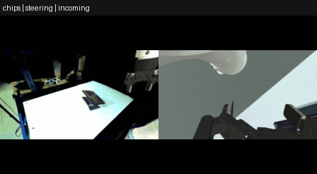
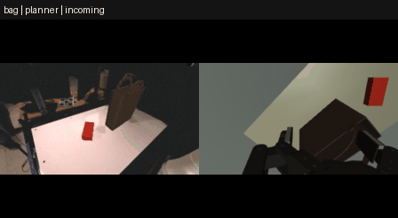
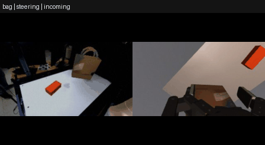
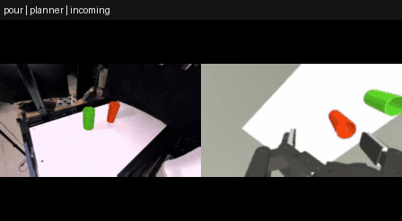
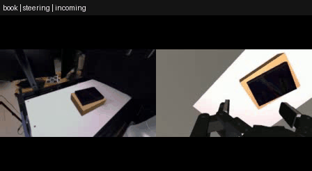
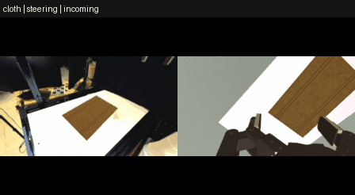

# steer_wam sim GIFs (2026-11-23)

MuJoCo digital twin of a Franka + Robotiq 2F-85 bench. Each tile is a rollout of either the scripted planner or the steered pi0.5-DROID policy (soft CS-Pi steering), shown as exterior camera | wrist camera side by side. Physics, visuals, camera and controller are domain-randomised. Tiles marked FAILURE or PRE-FIX / STOPGAP are not representative final results.

## Updates

- 2026-11-23: book_planner.gif replaced with the j6-legal planner success (seed 833001, 720 steps).
- 2026-11-23: chips_planner is a current success under standard settings (no longer treated as a stopgap); stopgap/pre-fix marks now follow the tile notes only.
- 2026-11-23: README regenerated from the gallery and status files.

## Chips bag (`chips`)

| GIF | Method | Seed | Steps | Outcome | Notes |
|---|---|---|---|---|---|
|  | planner | 800104 | 184 | success | pick up the packet, occlusion 50% |
|  | steering | 800001 | 152 | success | pull from under the book, occlusion 50% |

## Bag with handles (`bag`)

| GIF | Method | Seed | Steps | Outcome | Notes |
|---|---|---|---|---|---|
|  | planner | 800103 | 224 | success | after the gripper (trial-close ref) fix; planner acceptance 5/20 so far |
|  | steering | 800000 | 480 | **FAILURE** (**PRE-FIX / STOPGAP tile**) | bag_pilot2 predates the gripper bug fix; failure; to be replaced |

## Bag without handles (`bag_pick`)

| GIF | Method | Seed | Steps | Outcome | Notes |
|---|---|---|---|---|---|
|  | planner | 850002 | 80 | success | placement P1 |
|  | steering | 850002 | 72 | success | pilot_a |

## Pour (`pour`)

| GIF | Method | Seed | Steps | Outcome | Notes |
|---|---|---|---|---|---|
|  | planner | 840001 | 416 | success | 100% of grains into the orange cup, 0% spill, both cups upright (lip-fixed tilt) |
| (none yet) | steering | - | - | not yet available | - |

## Book to edge and pick (`book`)

| GIF | Method | Seed | Steps | Outcome | Notes |
|---|---|---|---|---|---|
|  | planner | 833001 | 720 | success | j6-legal scripted planner (SW_J6_LIMIT=1, grasp search j6 >= 1.65), stored randomised frames (VIS_RECORD), ext \| wrist at 15 fps; min j6 after start 1.980 rad |
|  | steering | 832000 | 480 | **FAILURE** | steered: slide done (overhang at step 159), side grasp never achieved; steering 0/60 for book tasks |

## Cloth (towel fold) (`cloth`)

| GIF | Method | Seed | Steps | Outcome | Notes |
|---|---|---|---|---|---|
|  | planner | 720000 | 176 | success (**PRE-FIX / STOPGAP tile**) | original steering-search settings (bench twin); bench-scene version being fixed |
|  | steering | 860000 | 272 | success | steered success (pilot without compliant arm); towel folded |

## Status

Quoted as written in the run status file (generated 2026-11-23).

| Task | Planner | Pilot (steering) | Data | Updated |
|---|---|---|---|---|
| Bag with handles (BAG) | not in doc conclusion; replay gate PASS (marginal) 4/5 held-out | pending (doc: 'filled in when the jobs end') | not stated in doc | 2026-11-23 02:31 |
| Bag without handles (BAGPICK) | 20/24 strict (83%), provisional | 8/12 strict | 8 episodes pass converter dry run (0 bad) and language audit; provider R2 verified (coordinator note; doc text still says provisional) | 2026-11-23 02:31 |
| Chips under book (CHIPS) | replay gate FAILS (0/9 no-contact replays pass); no acceptance run | not run | all pilot data provisional / untrusted | 2026-11-23 02:57 |
| Pour green to orange (POUR) | 21/24 strict (87.5%) | pending (placeholder in doc) | not stated in doc | 2026-11-23 03:14 |
| Book to edge and pick (BOOK) | 80/100 over 5 tasks (book_pick 12/20) | 0/60 (both variants) | nothing to convert (0 strict successes) | 2026-11-23 03:10 |
| Fold towel, MuJoCo (CLOTH) | 1-3/16, target >=70% NOT met | pending (doc: numbers pending) | not stated in doc | 2026-11-23 02:30 |
| Fold towel, Genesis PBD (GCLOTH) | no doc yet | no doc yet | no doc yet | - |
