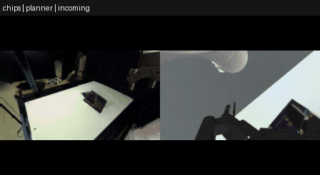
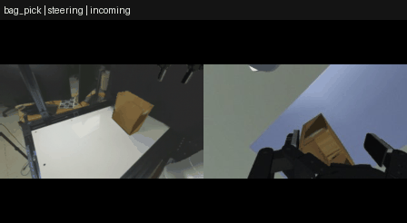
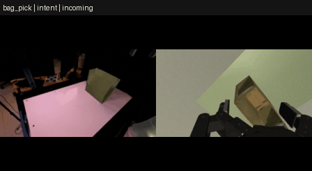
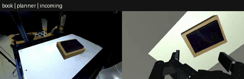
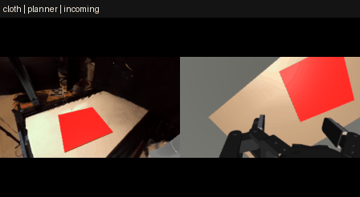
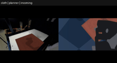
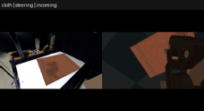
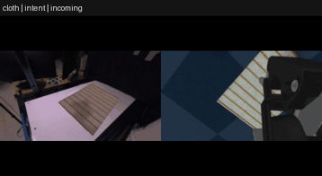

# steer_wam sim GIFs (2026-11-23)

MuJoCo digital twin of a Franka + Robotiq 2F-85 bench. Each tile is a rollout of either the scripted planner or the steered pi0.5-DROID policy (soft CS-Pi steering), shown as exterior camera | wrist camera side by side. Physics, visuals, camera and controller are domain-randomised. Tiles marked FAILURE or PRE-FIX / STOPGAP are not representative final results.

Intent-only steering (a variant) uses only the planner's direction to the next subgoal as the steering signal; every executed action, including the gripper, is the policy's own, with no planner actions.

**Intent-only steering results.**

Going forward, every steering method uses the planner's gripper timing; a single intent-only algorithm (position and orientation, planner gripper, one strength per task) is being evaluated. The results below used pi0.5's own gripper and are kept as comparisons.

- Bag without handles: pure intent-only 3/12; with the planner timing the gripper 6/12; current steering 12/12; planner 9/12; same 12 scenes.
- Book: intent-only 0/24 at every level tried; pi0.5 neither pushes the book to the edge nor turns its wrist to the side grasp, so book keeps the current steering; current steering 16/24, planner 18/24.
- Pour: blocked, because the planner fails under the real-arm settings.
- Cloth (Genesis PBD cloth): intent-only pi0.5's own actions and gripper, steered only toward a simple planner's subgoals. 1/5 strict on the same 8 seeds where the full planner gets 6/8, a simple planner 2/8 and unsteered pi0.5 0/4. Main failure: pi0.5's own gripper misses the cloth pinch.

## Updates

- 2026-11-24: chips_steering.gif replaced (seed 800460, 272 steps, success, pull from under the book; pilot 10/12, PROVISIONAL). Chips planner note: 18/24 pull, 21/24 pick at 50% occlusion.
- 2026-11-24: bag_steering.gif replaced (seed 800209, 312 steps, success; the earlier pre-fix failure tile is gone). Pilot 2/12; scripted planner 9/20 on this task.
- 2026-11-24: Wording: all steering going forward uses the planner's gripper timing; the two intent-only GIFs (bag without handles, Genesis cloth) are labelled as comparisons that used pi0.5's own gripper.
- 2026-11-24: cloth_genesis_intent.gif added (Genesis PBD cloth, intent-only steering, seed 860104, 432 steps, success; 1/5 strict overall); cloth result added to the intent-only summary.
- 2026-11-23: bag_planner.gif replaced (seed 800103, 168 steps, success, full real-arm settings); added an "Intent-only steering results" summary (bag_pick, book, pour).
- 2026-11-23: Genesis PBD cloth rows: steering pilot now 5/12 strict (was 3/6 so far); both Genesis rows now state the success criterion (each moved corner within 15 cm of its target). No GIF change.
- 2026-11-23: cloth_genesis_steering.gif added (Genesis PBD cloth, soft CS-Pi steering, seed 870100, 960 steps, success; pilot 3/6 so far; GIF at half frame rate). Chips steering note: real replay check still fails (packet placement), chips results remain provisional.
- 2026-11-23: Genesis PBD cloth planner note updated: 6 of 8 held-out seeds strict (7 of 8 by the task criterion). No GIF change.
- 2026-11-23: cloth_genesis_planner.gif added (Genesis PBD cloth, planner, seed 860100, 1040 steps, success; 3 of the first 5 held-out seeds so far; GIF at half frame rate). Existing cloth rows are labelled MuJoCo towel.
- 2026-11-23: bag_pick_intent.gif added (intent-only soft CS-Pi steering, seed 880004, 216 steps, success; pilot 3/12 strict vs scripted planner 9/12 on the same seeds).
- 2026-11-23: Intent-only on the book task: 0/24 so far (current steering 16/24, planner 18/24 on the same seeds).
- 2026-11-23: book_planner.gif replaced with the j6-legal planner success (seed 833001, 720 steps).
- 2026-11-23: chips_planner is a current success under standard settings (no longer treated as a stopgap); stopgap/pre-fix marks now follow the tile notes only.
- 2026-11-23: chips_planner.gif replaced (seed 800103, 272 steps, success, occlusion 50%, scripted planner on the creep-fixed packet asset).
- 2026-11-23: chips_steering.gif replaced (seed 800300, 128 steps, success under the real session's success criterion, soft CS-Pi steering of pi0.5, occlusion about 44% after settling). PROVISIONAL: recorded before the real-arm torque clamp and controller v3 were added; the chips replay gate is still pending.
- 2026-11-23: BOOK status line updated: planner v2 under the torque clamp 86/100 strict; steering with planner fallback and a new transit judge term 11/12 and 12/12, planner's own actions on about 67% of steps. book_steering.gif unchanged.
- 2026-11-23: README regenerated from the gallery and status files.
- 2026-11-23: pour_planner.gif replaced with the side-grasp pour success (seed 840001, 696 steps, 100% of grains in the orange cup, j6 kept above the real arm's limit).
- 2026-11-23: book_steering.gif replaced (the earlier failure is gone) with the first book steering success (seed 835000, 320 steps). This is NOT pure steering: the planner's own chunk was executed on 30% of steps (slide phase 80%, grasp phase 10%) and CS-Pi-guided pi0.5 on 70%.
- 2026-11-23: book_steering.gif replaced (seed 836105, 640 steps): steering with planner fallback under the real-arm torque-clamp settings; the planner's own chunk was executed on 26% of steps (slide 87%, grasp+lift 17%), pilot 2/12 strict. Not pure steering.
- 2026-11-23: cloth_steering.gif replaced (MuJoCo towel, seed 860000, 272 steps): same steering success re-rendered with the real brown terry towel look; run without the compliant-arm setting.

## Chips bag (`chips`)

| GIF | Method | Seed | Steps | Outcome | Notes |
|---|---|---|---|---|---|
|  | planner | 800103 | 272 | success | Occlusion 50%; scripted planner on the creep-fixed packet asset; planner 18/24 pull, 21/24 pick at 50% occlusion |
|  | steering | 800460 | 272 | success (**PROVISIONAL**) | Pull the packet from under the book, occlusion 50%. Soft CS-Pi steering of pi0.5 with the planner's gripper timing (current method, before the unified algorithm), full real-arm settings, episode length set from the real teleop trials. Pilot 10/12 (pull 4/6, pick 6/6). PROVISIONAL: the replay check against the real recordings still fails (packet placement). |

## Bag with handles (`bag`)

| GIF | Method | Seed | Steps | Outcome | Notes |
|---|---|---|---|---|---|
|  | planner | 800103 | 168 | success | scripted planner under the full real-arm settings (controller v3, torque clamp); real success criterion: block in the bag, bag lifted by a handle. |
|  | steering | 800209 | 312 | success | Soft CS-Pi steering of pi0.5 with the planner's gripper timing (current method, before the unified algorithm), full real-arm settings, real success criterion (block in the bag, bag lifted by a handle). Pilot 2/12; the scripted planner is 9/20 on this task. |

## Bag without handles (`bag_pick`)

| GIF | Method | Seed | Steps | Outcome | Notes |
|---|---|---|---|---|---|
|  | planner | 850002 | 80 | success | placement P1 |
|  | steering | 850002 | 72 | success | pilot_a |
|  | intent-only steering | 880004 | 216 | success | Comparison (pi0.5's own gripper): Intent-only soft CS-Pi: steering uses only the planner's direction to the next subgoal; every executed action, including the gripper, is pi0.5's own (no planner actions). Pilot 3/12 strict; the scripted planner gets 9/12 on the same seeds. |

## Pour (`pour`)

| GIF | Method | Seed | Steps | Outcome | Notes |
|---|---|---|---|---|---|
|  | planner | 840001 | 696 | success | scripted planner, SIDE GRASP (hand horizontal, tilt by wrist roll about the approach axis; j6 >= 1.57 throughout, min 1.603; SW_J6_LIMIT=1): 100% of grains in the orange cup, both upright, set down; SW_CTRL_DR=2 SW_SERVO_FF=1 SW_DR=1 SW_FORK_TC=last SW_CTRL_STIFF=1 SW_CAM_EPOCHS=BC |
| (none yet) | steering | - | - | not yet available | - |

## Book to edge and pick (`book`)

| GIF | Method | Seed | Steps | Outcome | Notes |
|---|---|---|---|---|---|
|  | planner | 833001 | 720 | success | j6-legal scripted planner (SW_J6_LIMIT=1, grasp search j6 >= 1.65), stored randomised frames (VIS_RECORD), ext \| wrist at 15 fps; min j6 after start 1.980 rad |
|  | steering | 836105 | 640 | success (with planner fallback on 26% of steps, not pure steering) | Book slide-to-edge then pick (book_platform_1). Steering with planner fallback under the real-arm settings (torque clamp SW_CTRL_CLAMP=1, controller v3, compliant arm, j6 limit): planner's own chunk executed on 26% of steps (slide 87%, grasp+lift 17%); the rest are CS-Pi-guided pi0.5 chunks. Pilot: 2/12 strict. Not pure steering. |

## Cloth (MuJoCo towel fold) (`cloth`)

| GIF | Method | Seed | Steps | Outcome | Notes |
|---|---|---|---|---|---|
|  | planner (MuJoCo towel) | 720000 | 176 | success (**PRE-FIX / STOPGAP tile**) | original steering-search settings (bench twin); bench-scene version being fixed |
|  | steering (MuJoCo towel) | 860000 | 272 | success | MuJoCo towel. Steering pilot success (soft CS-Pi, SW_CTRL_DR=2 SW_SERVO_FF=1 SW_DR=1 FORK_TC=last, no STIFF, 2 cm mesh, pre-calibration material), re-rendered by replaying its executed actions with the new towel visuals: B-spline skin + real brown terry dobby look (2026-11-22 towel), counter-light cloth tone; replay ends in strict success (log drift after the first trial close, mm-level) |
|  | planner (Genesis PBD cloth) | 860100 | 1040 | success | Towel parameters and success criterion taken from the owner's real thick-towel teleop half fold; physical friction-limited grasp (no pinning); full real-arm controller settings; 6 of 8 held-out seeds strict (7 of 8 by the task criterion); GIF at half frame rate. Success criterion from the real fold: each moved corner within 15 cm of its target, matching how far the real thick-towel corner landed. |
|  | steering (Genesis PBD cloth) | 870100 | 960 | success | Soft CS-Pi steering of pi0.5: every executed action is a CS-Pi-guided pi0.5 chunk (no planner actions); the planner only times the gripper close. Towel and success criterion from the owner's real thick-towel fold. Physical friction-limited grasp: 4 grasps and 24 physical near-miss grasps in this episode. Pilot 5/12 strict. GIF at half frame rate. Success criterion from the real fold: each moved corner within 15 cm of its target, matching how far the real thick-towel corner landed. |
|  | intent-only steering (Genesis PBD cloth) | 860104 | 432 | success | Comparison (pi0.5's own gripper): Intent-only steering: pi0.5's own actions and gripper, steered only toward a simple planner's subgoals. 1/5 strict on the same 8 seeds where the full planner gets 6/8, a simple planner 2/8 and unsteered pi0.5 0/4. Main failure: pi0.5's own gripper misses the cloth pinch. |

## Status

Quoted as written in the run status file (generated 2026-11-23).

| Task | Planner | Pilot (steering) | Data | Updated |
|---|---|---|---|---|
| Bag with handles (BAG) | not in doc conclusion; replay gate PASS (marginal) 4/5 held-out | pending (doc: 'filled in when the jobs end') | not stated in doc | 2026-11-23 04:23 |
| Bag without handles (BAGPICK) | 20/24 strict (83%), provisional | 8/12 strict | 8 episodes pass converter dry run (0 bad) and language audit; provider R2 verified (coordinator note; doc text still says provisional) | 2026-11-23 02:31 |
| Chips under book (CHIPS) | replay gate FAILS (0/9 no-contact replays pass); no acceptance run | not run | all pilot data provisional / untrusted | 2026-11-23 03:48 |
| Pour green to orange (POUR) | top-down rim grasp 21/24 (87.5%), not valid for the real arm (j6 1.49-1.55); side grasp (j6-legal) 5/21 (24%) | no steering pilot episode completed; "Not ready for steering data" | planner-only numbers; no pour steering tile | 2026-11-23 04:00 |
| Book to edge and pick (BOOK) | planner v2 under the torque clamp: 86/100 strict | steering with planner fallback and a new transit judge term: 11/12 and 12/12 strict (the planner's own actions on about 67% of steps; not pure steering); earlier steering without fallback 0/60 | planner data: 500 episodes (100 per task), 189,600 frames, 15.9 GB; converter dry run 0 bad, language audit 500/500 | 2026-11-23 04:31 |
| Fold towel, MuJoCo (CLOTH) | 1-3/16, target >=70% NOT met | pending (doc: numbers pending) | not stated in doc | 2026-11-23 02:30 |
| Fold towel, Genesis PBD (GCLOTH) | no doc yet | no doc yet | no doc yet | - |
